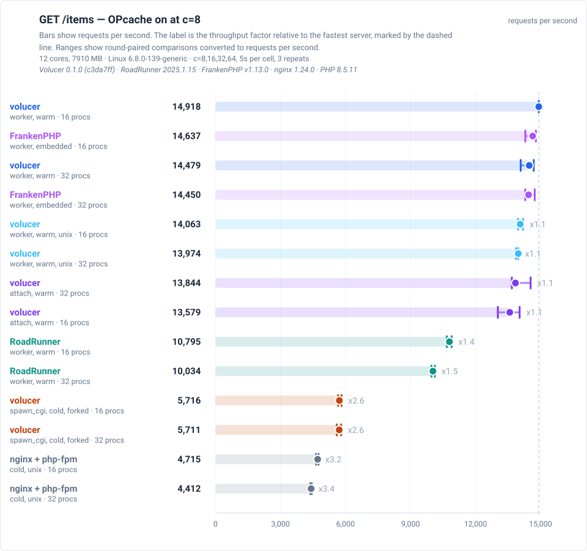
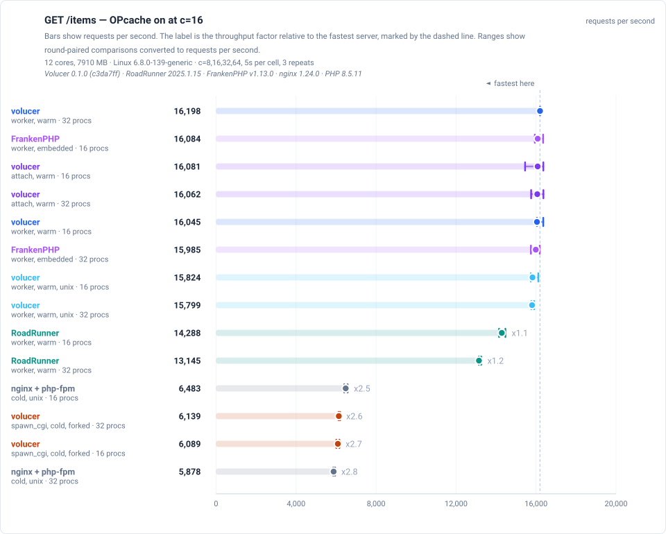
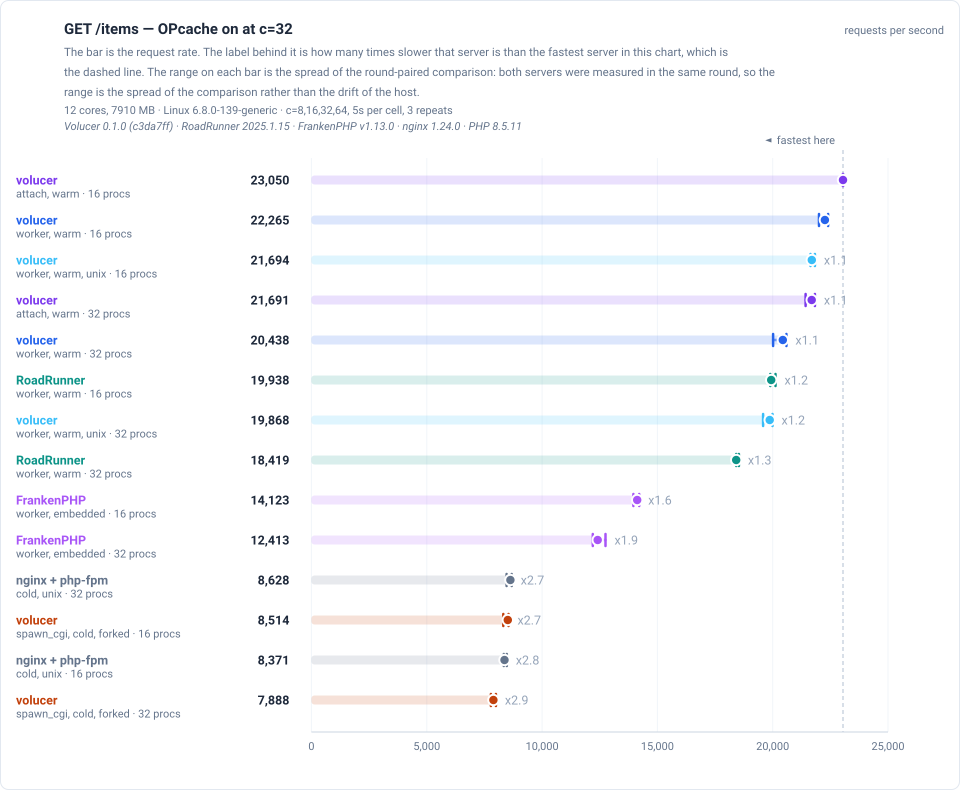
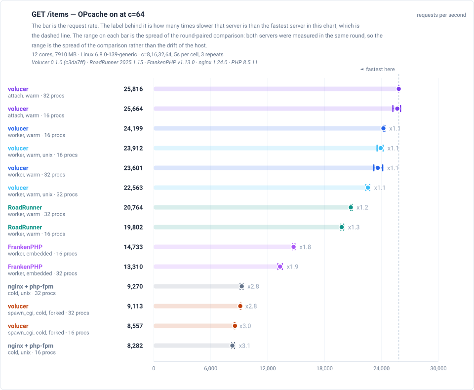
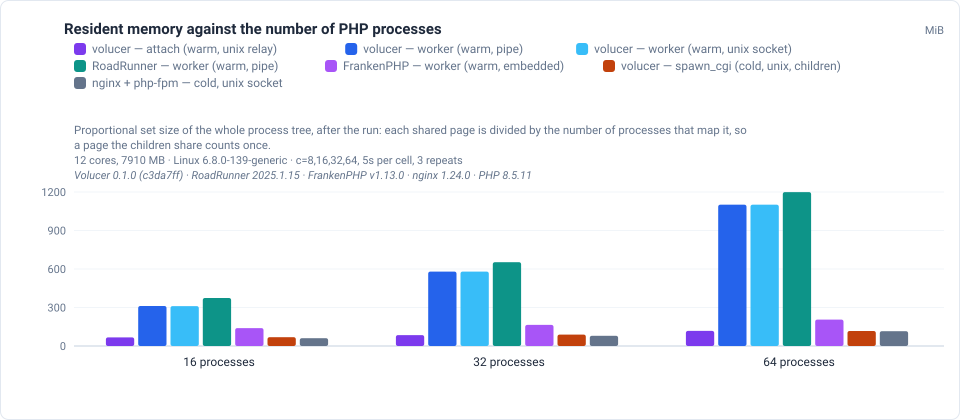
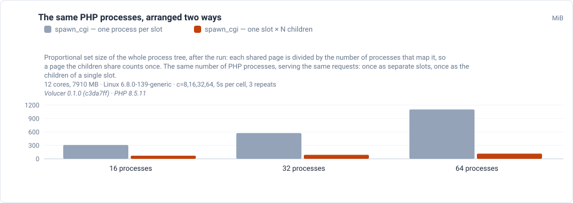

# Benchmarks

Volucer against RoadRunner, FrankenPHP and nginx + php-fpm, every arm through one harness on one interpreter - and what each of them costs in memory.

**Measured, not estimated.** Every number on this page comes from one committed
result file in
[`volucer-competition`](https://github.com/sailantis/volucer-competition), and the
charts are generated from that same file — so a chart cannot disagree with the table
beside it. A cell with no successful repeat is printed as `-`, never as `0`: a zero reads
as "measured, and it was terrible" rather than "not measured". The method, the raw rows
and the controls live in that repository.

**One host, one harness, one interpreter, one pass.** Every figure below was measured on
the same machine, through the same script, against the same PHP build, in one
interleaved pass — so a ratio between two arms is a ratio between two measurements made
the same way. **Each chart names the host and the method it was measured on, and the
build of every program it measured**, so the image is readable on its own and a figure
is never a fact about a version no one can identify.

## `GET /items` — the ORM page

Every row below was measured in **one interleaved pass** — every arm, at every process count, at every load, in one round-robin over one host, with the order rotating so that no cell is always first and no cell is always last. The **PHP procs** column is the cost side of the comparison: it says how many PHP processes serve the requests, and it is what the host pays for.

The `spawn_cgi` arm with `children` puts several processes behind one listening socket, so it reaches a given throughput with a different amount of server than the arms beside it. That is why the process count is a column and not a footnote: a row with more processes is not a better row, it is a row that bought its throughput with more server.

Each chart is a bar per server, and the bar is the **request rate** — the number the page is about. The bars start at zero, so their lengths can be compared directly.

**The label behind each bar is how many times slower that server is than the fastest server in the same chart.** The fastest server is the dashed vertical line, and it carries no label of its own; every other bar states its factor — `x2.5` for a server that did 40% of the leader's requests per second. The baseline is the fastest server *in that chart*, not a fixed server: a cold deployment can overtake a warm one as the host saturates, so the fastest server is not necessarily the same one at every load — and naming it per chart is more honest than a fixed reference that would read as a claim about the same winner every time.

**The range on each bar is the spread of the comparison, not of the server.** Both servers were measured once per round, interleaved, so each round holds a ratio of the two. The range is the smallest and largest of those round-paired ratios, scaled back into requests per second. Pairing by round is what makes that range honest: a host that drifts over the run moves both servers in the same round, so the ratio within a round is steadier than either server's own spread. A range drawn from one server's minimum and maximum would instead charge the whole of the host's drift to that one server, and would be wide for the wrong reason.

A range that reaches across the 1.0 line means the two servers could not be told apart in this run. The table marks those rows **tie**: a difference inside the measurement's own spread is not a difference, and the factor there is the best estimate rather than a claim that one server is faster.

### OPcache on

The **factor** column is measured against **the fastest server in the table**, which is the row marked `x1.0`. It states how many times slower each server is, so `x1.0` is the fastest and `x2.5` is a quarter of its rate. The column carries the range of the round-paired ratios beside it, and a row marked **tie** is one whose range reaches across 1.0 — the two servers could not be told apart in this run.

| server | model | PHP procs | rps | p50 | p99 | factor (range) |
|---|---|---:|---:|---:|---:|---:|
| volucer | attach (warm, unix relay) | 32 | **25,816** | 2.17 ms | 5.02 ms | x1.0 |
| volucer | attach (warm, unix relay) | 16 | **25,664** | 2.2 ms | 6.73 ms | x1.0 (0.99–1.02) — tie |
| volucer | worker (warm, pipe) | 16 | **24,199** | 2.35 ms | 7.36 ms | x1.1 (1.06–1.07) |
| volucer | worker (warm, unix socket) | 16 | **23,912** | 2.37 ms | 7.23 ms | x1.1 (1.07–1.10) |
| volucer | worker (warm, pipe) | 32 | **23,601** | 2.38 ms | 5.59 ms | x1.1 (1.07–1.11) |
| volucer | worker (warm, unix socket) | 32 | **22,563** | 2.51 ms | 5.83 ms | x1.1 (1.13–1.16) |
| RoadRunner | worker (warm, pipe) | 32 | **20,764** | 2.65 ms | 7.57 ms | x1.2 (1.23–1.24) |
| RoadRunner | worker (warm, pipe) | 16 | **19,802** | 2.86 ms | 5.52 ms | x1.3 (1.29–1.31) |
| FrankenPHP | worker (warm, embedded) | 16 | **14,733** | 3.81 ms | 8.35 ms | x1.8 (1.73–1.77) |
| FrankenPHP | worker (warm, embedded) | 32 | **13,310** | 4.02 ms | 14.82 ms | x1.9 (1.91–1.97) |
| nginx + php-fpm | cold, unix socket | 32 | **9,270** | 6.19 ms | 9.75 ms | x2.8 (2.74–2.84) |
| volucer | spawn_cgi (cold, unix, children) | 32 | **9,113** | 6.36 ms | 12.89 ms | x2.8 (2.81–2.83) |
| volucer | spawn_cgi (cold, unix, children) | 16 | **8,557** | 6.81 ms | 16.61 ms | x3.0 (3.02–3.05) |
| nginx + php-fpm | cold, unix socket | 16 | **8,282** | 7.03 ms | 9.52 ms | x3.1 (3.03–3.15) |

**The two cold deployments, head to head.** `spawn_cgi` with `children` and `nginx + php-fpm` are the same idea reached two ways — a forked pool of `php-cgi` children behind one socket, or a pool of `php-fpm` children behind another. The table below holds the pair at each process count the run covered, so the two are compared with the amount of server held equal:

| PHP procs | server | model | rps | spawn_cgi ÷ php-fpm |
|---:|---|---|---:|---:|
| 16 | volucer | spawn_cgi (cold, unix, children) | **8,557** | x1.03 |
| 16 | nginx + php-fpm | cold, unix socket | **8,282** | — |
| 32 | volucer | spawn_cgi (cold, unix, children) | **9,113** | x0.98 |
| 32 | nginx + php-fpm | cold, unix socket | **9,270** | — |

The factor is `spawn_cgi`'s rate divided by php-fpm's at the same process count, so `x1.0` is level and a factor above 1.0 means the forked pool served more requests with the same number of PHP processes.

**What the extra processes buy.** The table below is each arm at the smallest and the largest serving-process count this comparison publishes, paired by the round each was measured in, with the ratio of the two and its range. A ratio above 1.0 means the arm served more requests with the larger process count; a ratio below 1.0 means it served fewer; and a range that reaches across 1.0 means the two tiers could not be told apart in this run:

| server | model | 16 procs | 32 procs | 32/16 (range) |
|---|---|---:|---:|---:|
| volucer | attach (warm, unix relay) | 25,664 | 25,816 | x1.01 (0.99–1.02) |
| volucer | worker (warm, pipe) | 24,199 | 23,601 | x0.98 (0.96–0.99) |
| volucer | worker (warm, unix socket) | 23,912 | 22,563 | x0.94 (0.94–0.95) |
| RoadRunner | worker (warm, pipe) | 19,802 | 20,764 | x1.05 (1.04–1.05) |
| FrankenPHP | worker (warm, embedded) | 14,733 | 13,310 | x0.90 (0.88–0.91) |
| volucer | spawn_cgi (cold, unix, children) | 8,557 | 9,113 | x1.07 (1.07–1.08) |
| nginx + php-fpm | cold, unix socket | 8,282 | 9,270 | x1.12 (1.10–1.12) |

**The 64-process tier is measured and is not in the throughput table above.** The rows are in the repository, and the memory section below publishes every tier the run covered — memory is a cost of a deployment rather than a claim about who is faster, so it has no reason to stop where the throughput comparison does.

## What it costs in memory

**Proportional set size (PSS)**, of the whole process tree, after the run. PSS divides every shared page by the number of processes that map it, which is what makes it the figure that can be compared across process models: a page that thirty-two `php-fpm` children share counts once, and a page that thirty-two separate processes each hold counts thirty-two times.

**Resident set size (RSS)** is printed beside it in brackets, because it is the number `htop` shows and the number most people quote — and it counts a shared page once per process that maps it, so it reports a cost that the host does not pay. Both are given, so nothing is hidden and neither is mistaken for the other.

| server | model | 16 procs | 32 procs | 64 procs |
|---|---|---:|---:|---:|
| volucer | attach (warm, unix relay) | 67.0 (414) | 85.1 (760) | 117.6 (1,417) |
| volucer | worker (warm, pipe) | 311.6 (820) | 579.8 (1,620) | 1101.3 (3,201) |
| volucer | worker (warm, unix socket) | 310.7 (819) | 579.8 (1,618) | 1101.4 (3,201) |
| RoadRunner | worker (warm, pipe) | 374.1 (880) | 653.0 (1,690) | 1199.3 (3,306) |
| FrankenPHP | worker (warm, embedded) | 139.7 (140) | 164.7 (165) | 205.6 (206) |
| volucer | spawn_cgi (cold, unix, children) | 68.9 (490) | 89.0 (914) | 116.5 (1,701) |
| nginx + php-fpm | cold, unix socket | 60.8 (501) | 79.2 (926) | 115.6 (1,789) |

Each cell is the **PSS** of the deployment, with its **RSS** in brackets — the same number `htop` shows, which counts a shared page once per process that maps it.

### The same PHP processes, arranged two ways

The `children` key exists to answer one question: for the same number of PHP processes, is a forked slot cheaper than one process per slot? The comparison has to hold the process count equal, or it is comparing two different amounts of server.

| shape | PHP processes | median PSS (MiB) | min | max | vs one per slot |
|---|---:|---:|---:|---:|---:|
| 16 separate slots | 16 | **309.8** | 309.8 | 311.6 | — |
| 1 slot × 16 children | 16 | **68.9** | 67.6 | 69.1 | 4.5× less |
| 32 separate slots | 32 | **574.4** | 573.8 | 576.7 | — |
| 1 slot × 32 children | 32 | **89.0** | 85.9 | 90.0 | 6.5× less |
| 64 separate slots | 64 | **1102.9** | 1101.0 | 1103.4 | — |
| 1 slot × 64 children | 64 | **116.5** | 115.3 | 116.7 | 9.5× less |

The **vs one per slot** column is the row's own median divided by the one-process-per-slot row at the same process count, so it states how much less memory the forked pool holds for the same amount of server. Read it across a row of the table, not between two rows: the comparison holds the process count equal, and comparing two different counts would compare two different amounts of server.

The reason the two arrangements differ is that the children inherit the master's pages instead of each mapping its own copy, so a page the pool shares is paid for once rather than once per process. That is the argument for the `children` key, and it is why the `spawn_cgi` arm with `children` is the shape that appears in the throughput comparison above: it is the same cold path as one process per slot, at a fraction of the memory.

## What was measured

**Every number on this page belongs to these versions.** A throughput figure is a fact about a version of a program, not about the program in general: the same measurement on another build is another number. These are the versions this run used, read from the run's own record, and the raw rows are in [`volucer-competition`](https://github.com/sailantis/volucer-competition).

| what | version |
|---|---|
| PHP (CLI) | PHP 8.5.11 (cli) |
| PHP (CGI) | PHP 8.5.11 (cgi-fcgi) |
| PHP (FPM) | PHP 8.5.11 (fpm-fcgi) |
| Volucer | volucer 0.1.0 |
| Volucer commit | c3da7ff |
| RoadRunner | 2025.1.15 |
| FrankenPHP | v1.13.0 |
| nginx | nginx/1.24.0 (Ubuntu) |
| Bench app commit | a4d44df |

The **host** is the machine all of them ran on, the **method** is the harness that drove them, and the **builds** are the versions of the programs compared — all three are printed on every chart above, so a reader who has only the image still knows what it measured. One host, one harness, one interpreter, one pass: that is what makes a ratio between two arms a ratio between two measurements made the same way.
